# Бардия Ализаде · Farland_game
[English](https://github.com/FarlandGame/FarlandGame/blob/main/README.md) · [فارسی](https://github.com/FarlandGame/FarlandGame/blob/main/docs/README.fa.md) · [日本語](https://github.com/FarlandGame/FarlandGame/blob/main/docs/README.ja.md) · [Русский](https://github.com/FarlandGame/FarlandGame/blob/main/docs/README.ru.md)

Я **Бардия Ализаде**, также известный как **Кабир** и **Farland_game**. Здесь собраны мои программы, анимация, книга, музыка и история творческого пути.

### [Архив Blender · 28 файловых записей / 25 пакетов исходников 🎬📂](https://github.com/FarlandGame/Animation-Portfolio/blob/main/sources/blender/ru/index.md)

<!-- PORTFOLIO_DIRECTORY_START -->

## Моё портфолио ✨
Выберите карточку, чтобы посмотреть, прочитать или скачать работу. У каждого раздела есть собственное описание. 🎮🎬

| | |
|:--:|:--:|
| <a href="https://github.com/FarlandGame/Animation-Portfolio/blob/main/collections/ru/main.md">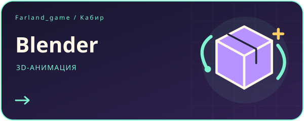</a> <a href="https://github.com/FarlandGame/Animation-Portfolio/blob/main/collections/ru/main.md">Blender · 3D-анимация</a> |  <a href="https://github.com/FarlandGame/Animation-Portfolio/blob/main/collections/ru/roblox.md">Roblox · Studio и монтаж</a> |
| <a href="https://github.com/FarlandGame/Animation-Portfolio/blob/main/history/phone-era/ru/index.md">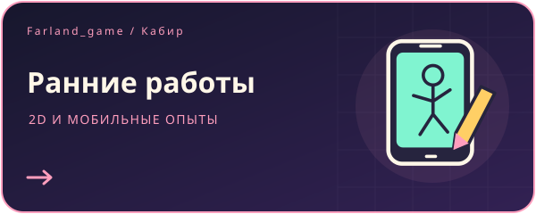</a> <a href="https://github.com/FarlandGame/Animation-Portfolio/blob/main/history/phone-era/ru/index.md">Ранние работы · 2D и телефон</a> |  <a href="https://farlandgame.github.io/Personal-Portfolio/?lang=ru">Моя история · фото и видео</a> |
| <a href="https://github.com/FarlandGame/Apps-Portfolio/blob/main/projects/rokhdesk/ru.md">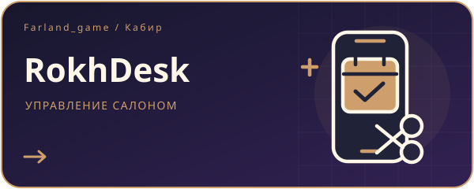</a> <a href="https://github.com/FarlandGame/Apps-Portfolio/blob/main/projects/rokhdesk/ru.md">RokhDesk · Android-приложение</a> | <a href="https://github.com/FarlandGame/Farland_autcliker/blob/main/docs/README.ru.md">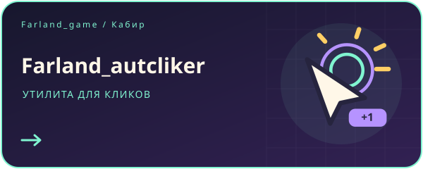</a> <a href="https://github.com/FarlandGame/Farland_autcliker/blob/main/docs/README.ru.md">Farland_autcliker</a> |
| <a href="https://github.com/FarlandGame/Vexland_Manhunt/blob/main/docs/README.ru.md">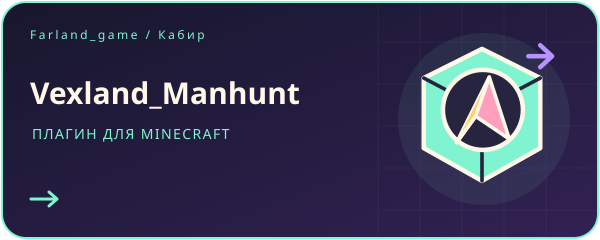</a> <a href="https://github.com/FarlandGame/Vexland_Manhunt/blob/main/docs/README.ru.md">Vexland_Manhunt</a> | <a href="https://github.com/FarlandGame/GoldBrain/blob/main/docs/README.ru.md">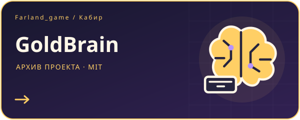</a> <a href="https://github.com/FarlandGame/GoldBrain/blob/main/docs/README.ru.md">GoldBrain · архив исходников</a> |
|  <a href="https://farlandgame.github.io/Music-Portfolio/?lang=ru">Музыка · персидский и японский</a> | <a href="https://github.com/FarlandGame/Visual-Animation-Tutorial/blob/main/docs/README.ru.md">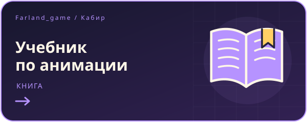</a> <a href="https://github.com/FarlandGame/Visual-Animation-Tutorial/blob/main/docs/README.ru.md">Visual Animation Tutorial · книга</a> |
| <a href="https://github.com/FarlandGame/FarlandGame/blob/main/docs/credentials/README.ru.md">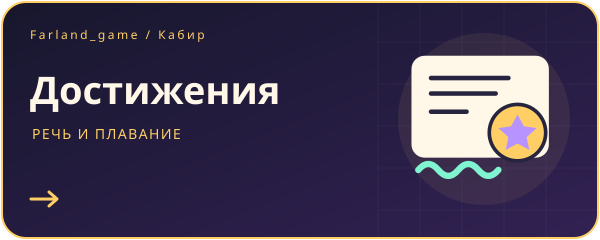</a> <a href="https://github.com/FarlandGame/FarlandGame/blob/main/docs/credentials/README.ru.md">Документы · речь и плавание</a> |  |
<!-- PORTFOLIO_DIRECTORY_END -->

## Приложения и продукты

**RokhDesk** — Android-приложение для салона Rokh Be Rokh в Мараге: клиенты, запись по календарю Джалали и расчёты. Разработчик — я; господин Хамид — пользователь и управляющий салоном. Здесь представлены реальный интерфейс, проверяемое описание и рекламные материалы. Код и APK остаются закрытыми.

[Приложения](https://github.com/FarlandGame/Apps-Portfolio/blob/main/docs/README.ru.md) · [RokhDesk: подробности](https://github.com/FarlandGame/Apps-Portfolio/blob/main/projects/rokhdesk/ru.md)

[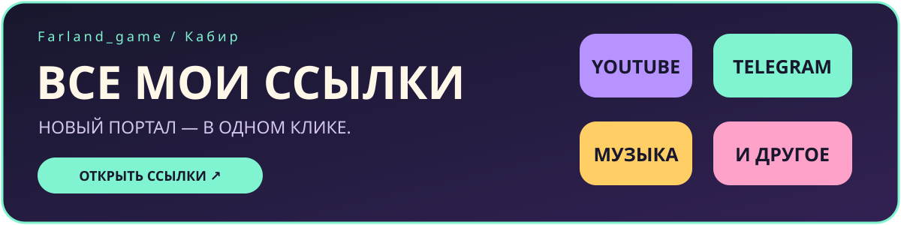](https://farlandgame.github.io/Personal-Portfolio/links/?lang=ru)

## Зовите меня Кабир 😎
Кабир — имя, которое я выбрал для себя, а Farland_game — моя творческая идентичность. Я хочу создавать запоминающиеся работы, развивать своё имя и руководить командой, у которой есть идеи, достойные воплощения.

Моя история началась примерно в шесть лет: мы с братом-близнецом **Армией** изучали телефон и ноутбук тёти. Minecraft вдохновил меня на создание игр. Из-за ограниченного оборудования я начал анимировать в **Stick Nodes на телефоне**. Собственный ноутбук примерно в пятнадцать лет открыл программирование, **Blender**, **After Effects** и совместные проекты с друзьями.

Я общительный, амбициозный и люблю организовывать командную работу. Сол Гудман из **Better Call Saul** вдохновляет меня уверенностью, находчивостью и искусством речи. Мои планы — учиться анимации в **Японии**, делиться знаниями как преподаватель, а затем открыть международную анимационную студию с отделениями разных направлений и позднее игровую студию. Это мои цели, а не уже полученные должности. 🇯🇵🎬

> Анимация, код, книга, команда… кнопка «принять новый квест» у меня явно не заедает. 🎮🔥

Моя фирменная фраза: **My name is Bardiya Kabir — Mr. King of Gods. But you can call me Farland_game.** 🎤

[Моя полная история](https://github.com/FarlandGame/FarlandGame/blob/main/docs/story.ru.md)

### Фан-арт? Буду рад! 🎨
Нарисуйте моих Minecraft- и Roblox-персонажей или меня самого: смешно, драматично, стильно — в вашем стиле. Если публикуете рисунок на Pinterest или другой площадке, укажите **Farland_game** и ссылку на это портфолио.

[Референсы персонажей](https://github.com/FarlandGame/FarlandGame/blob/main/docs/story.ru.md#fan-art) · [Мой Roblox](https://www.roblox.com/users/7889384276/profile)

*При встрече — «доруд», на прощание — «бедруд»: мои любимые приветствие и прощание. 👋*

## Моя история в фотографиях и видео 📸🎬
**134 изображения и 12 видео**: детство, семья и друзья, выход книги, портреты, творческие эксперименты и THE APEX — наш продолжающийся сюжетный Minecraft-проект. Есть короткая анимация в стиле Minecraft длительностью 11,67 секунды. Авторы совместных работ указаны отдельно; изображения с ИИ не выдаются за обычную съёмку.

> В журнал квестов наконец попал и тот, кто держит контроллер. 🎮📸

[Галерея и истории](https://farlandgame.github.io/Personal-Portfolio/?lang=ru) · [Архив](https://github.com/FarlandGame/Personal-Portfolio/blob/main/docs/README.ru.md)

## Музыка и обложки 🎧🎵
Два проекта на японском и персидском, созданные и организованные мной с помощью ИИ: **雨よ来い — «Приди, дождь»** и **چرخ زمان بازمیگردد — «Колесо времени поворачивает вспять»**.

Идея: Claude → текст: ChatGPT → музыка: Suno → извлечение звука: InShot → обложки: Photoshop и ИИ. По моим словам, обе песни также опубликованы в моём SoundCloud. Это не заявка на живой вокал или ручное исполнение всех инструментов.

> Моим анимации и коду, похоже, тоже понадобился саундтрек. 🎮🎵

[Слушать оба трека](https://farlandgame.github.io/Music-Portfolio/?lang=ru) · [SoundCloud](https://soundcloud.com/bardiya-kabir-798008614)

## Речь и плавание 🎤🏊
**Ораторское мастерство:** академия Rahkar, преподаватель Таха Бамшад, 30 часов, оценка 100/100. Национальный идентификатор скрыт. Изображение ниже — неофициальный русский перевод.

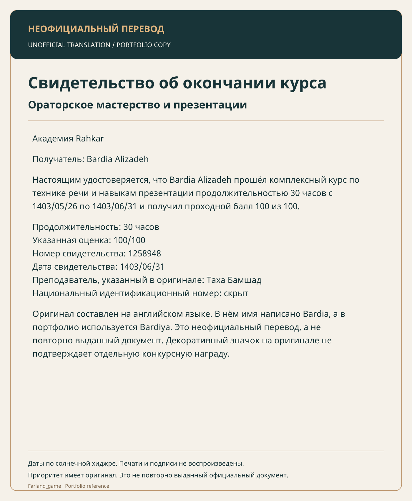

**Плавание:** документы подтверждают участие в водных мероприятиях. Я помню первое место в бассейне Rasad в Мараге, но не помню дату, дистанцию, стиль и категорию. Оба документа не содержат места; фестивальный документ указывает Athar Pool. Моя память и документальные сведения представлены отдельно.

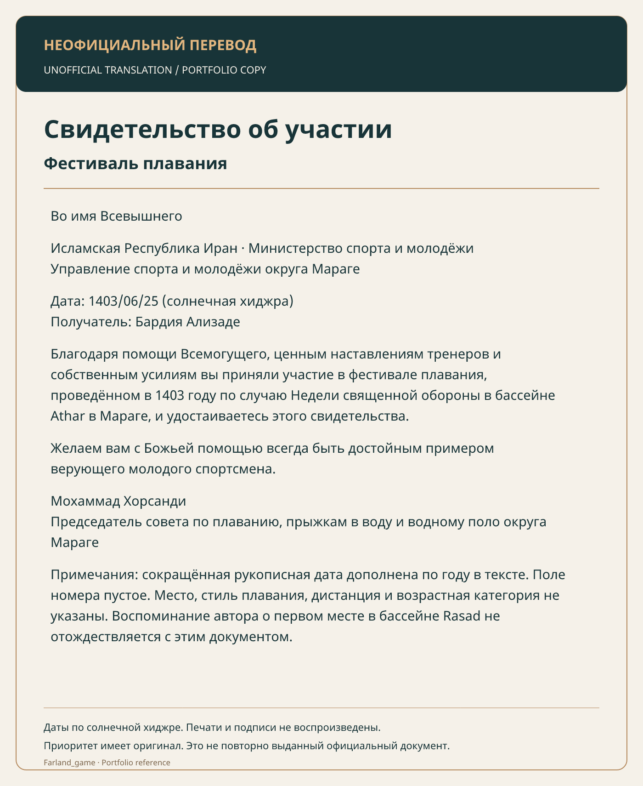

[Ораторское мастерство](https://github.com/FarlandGame/FarlandGame/blob/main/docs/credentials/public-speaking.ru.md) · [Плавание](https://github.com/FarlandGame/FarlandGame/blob/main/docs/credentials/swimming.ru.md)

## GoldBrain 🧠✨
**Семь месяцев обучения и незавершённый финансовый исследовательский проект, который можно продолжить.** Создан мной и моим братом Армией Ализаде (ArmiyaFbix). Я начинал почти без знаний программирования и учился через эксперименты, интернет и помощь ИИ.

Flutter-интерфейс, Python/FastAPI, данные рынка, новости, экспериментальные прогнозы и API бумажной торговли. Планы для Windows и Android включали кратко- и долгосрочные прогнозы и автоматическую торговлю Wallex с выбранным бюджетом. Стоимость инфраструктуры, сложность и финансовый риск заставили меня остановиться. **Итоговая система прогнозирования и торговля настоящими деньгами не завершены и не проверены.** Исходники и руководство по продолжению опубликованы под MIT с сохранением имён обоих авторов.

> У мозга были большие планы. У счёта за инфраструктуру — тоже. 🧠🧾😅

[Исходники и история](https://github.com/FarlandGame/GoldBrain/blob/main/docs/README.ru.md) · [Как продолжить](https://github.com/FarlandGame/GoldBrain/blob/main/docs/CONTINUING.md)

## Анимация и визуальные работы 🎬
**35 видео в четырёх коллекциях и 208 изображений.** Основная серия — 8 видео, Roblox — 11, ранние опыты — 3, исторический телефонный архив — 13 видео и 46 фотографий школы. Среди исторических файлов есть съёмка в играх, смешанная техника и заставка, поэтому не каждый файл — отрендеренный анимационный фильм.

Основная анимация — **Blender**; работы **07 и 08** дополнены монтажом **After Effects**. Работа **08** предоставлена в **4K (3840 × 2160)**; **04 не завершена**. Полные видео не сокращены. В четырёх случаях по моей просьбе опубликованы перекодированные копии полной длительности, оригиналы сохранены локально.

> Большие идеи, кубические герои и вечный побочный квест: дождаться рендера. 🎬🍿

[Основная серия](https://github.com/FarlandGame/Animation-Portfolio/blob/main/collections/ru/main.md) · [Roblox](https://github.com/FarlandGame/Animation-Portfolio/blob/main/collections/ru/roblox.md) · [Ранние опыты](https://github.com/FarlandGame/Animation-Portfolio/blob/main/collections/ru/early.md) · [Визуальная галерея](https://github.com/FarlandGame/Animation-Portfolio/blob/main/gallery/ru/index.md)

### Исходники Blender
**28 файловых записей, 25 доступных пакетов исходников.** Не каждая запись — независимый проект: есть предыдущие сохранения, эксперименты и незавершённые сцены. Даты описывают последнее изменение предоставленного файла, а не доказанную дату начала работы. Исходные материалы на моём компьютере не изменялись.

Мои подходящие оригинальные материалы — **CC BY-NC 4.0**: только некоммерческое использование, указание автора, лицензии и внесённых изменений. Чужие ресурсы сохраняют собственные условия. B08, B10 и смешанная библиотека B27 представлены для ознакомления без публичной раздачи соответствующего сырого материала.

[Проекты и загрузки](https://github.com/FarlandGame/Animation-Portfolio/blob/main/sources/blender/ru/index.md)

### Телефонный архив 📱
Сохранившиеся работы со школьных лет: Stick Nodes, биография в смешанной технике, Minecraft-истории, первая оригинальная 3D-сцена на телефоне и заставка канала. Это история обучения, а не демонстрация сегодняшнего уровня.

> У первых кадров уверенности было больше, чем ключевых поз. 📱😄

[Открыть ранний архив](https://github.com/FarlandGame/Animation-Portfolio/blob/main/history/phone-era/ru/index.md) · [Фотографии школьных локаций](https://github.com/FarlandGame/Animation-Portfolio/blob/main/history/phone-era/ru/school-01.md)

## Visual Animation Tutorial · книга 📚
Иллюстрированная работа братьев-близнецов **Бардии и Армии Ализаде**. **77-страничное руководство на персидском**: персонажи, позы, тайминг, интерполяция, камера, эффекты, сцена, монтаж и звук в Stick Nodes на телефоне. Шесть глав связывают историю и стили анимации с практикой.

В персидском издании и каталогах указан Бардия; портфолио также признаёт вклад Армии и совместную английскую версию. **Английское издание с жёлтой обложкой ещё готовится к публикации на Amazon; действующая ссылка покупки пока не заявлена.** ISBN персидского издания: **978-622-449-026-1**. Русский язык этой страницы не означает существование русского издания книги.

[Книга и разрешённые фрагменты](https://github.com/FarlandGame/Visual-Animation-Tutorial/blob/main/docs/README.ru.md) · [Армия на YouTube](https://www.youtube.com/@ArmiyaFabix)

### Благодарность за авторскую работу
Управление образования Мараге вручило мне благодарственную грамоту за книгу; дата документа — **1404/09/09** по солнечной хиджре. Это местное признание авторской работы.

[Грамота, оригинал и перевод](https://github.com/FarlandGame/Visual-Animation-Tutorial/blob/main/docs/recognition.ru.md)

## Утилиты и Minecraft
**Farland_autcliker:** моя утилита для автоматических кликов. [Описание и загрузка](https://github.com/FarlandGame/Farland_autcliker/blob/main/docs/README.ru.md).

**Vexland_Manhunt:** совместный Minecraft-плагин с **Али Дехганнежадом / Alivexor**. Версии и ветки имеют разные возможности; смотрите требования и руководство выбранной версии. [Плагин и документация](https://github.com/FarlandGame/Vexland_Manhunt/blob/main/docs/README.ru.md).

## Связь и площадки
**Рабочая почта:** [farland.game158@gmail.com](mailto:farland.game158@gmail.com)

[Все мои ссылки — каналы, музыка и сообщества](https://farlandgame.github.io/Personal-Portfolio/links/?lang=ru)
