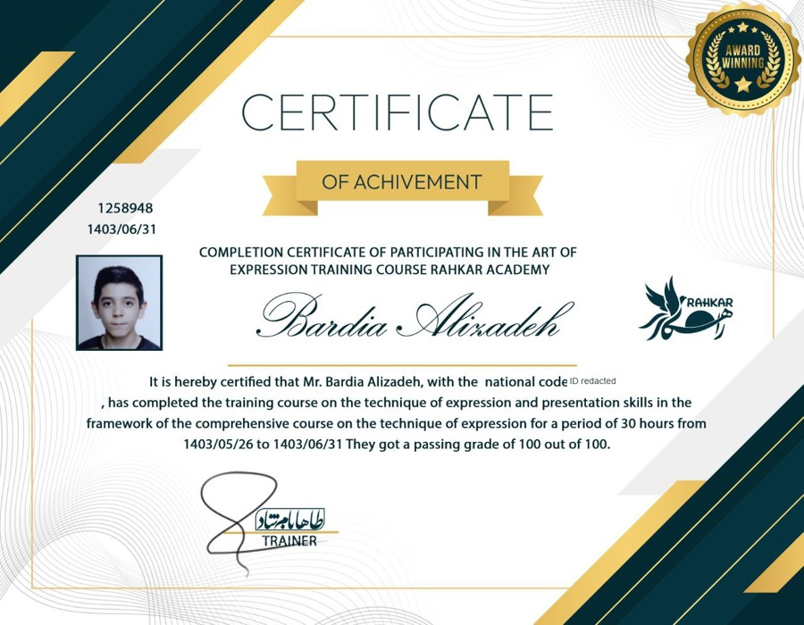
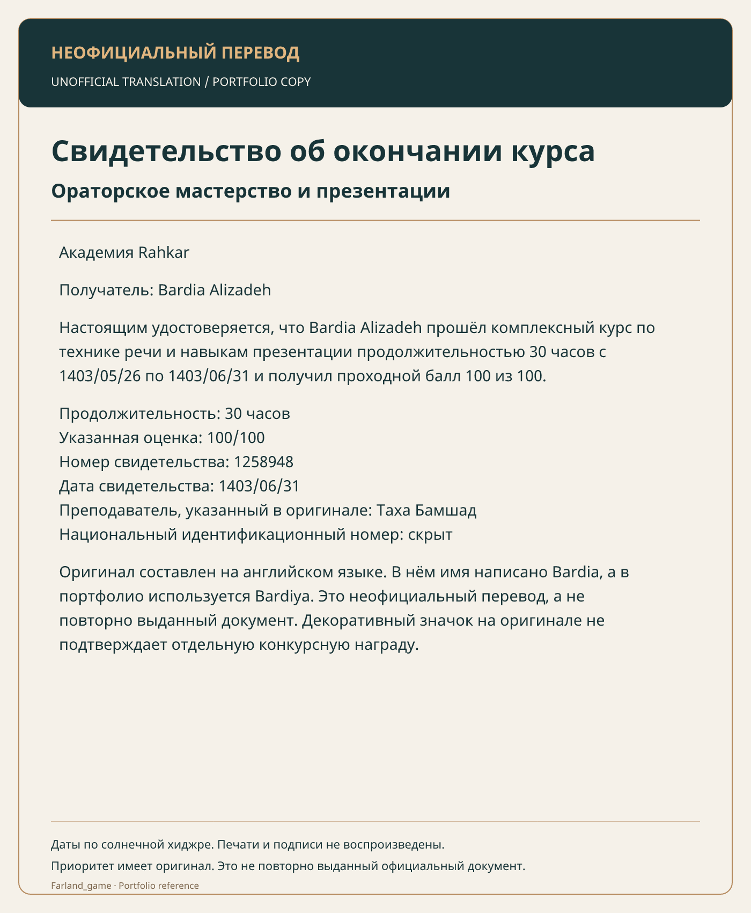
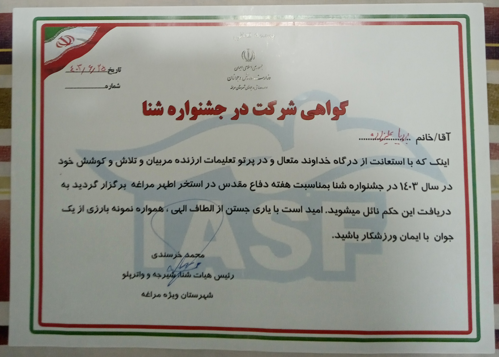
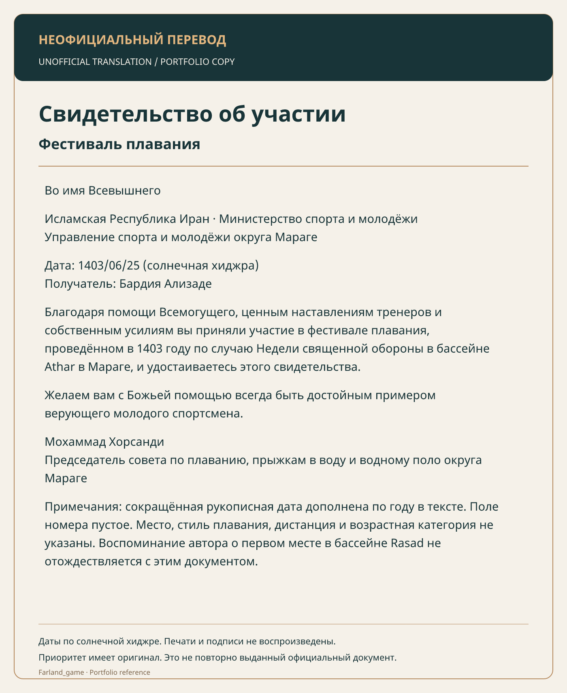

# Речь и плавание 🎤🏊
[English](https://github.com/FarlandGame/FarlandGame/blob/main/docs/credentials/README.en.md) · [فارسی](https://github.com/FarlandGame/FarlandGame/blob/main/docs/credentials/README.fa.md) · [日本語](https://github.com/FarlandGame/FarlandGame/blob/main/docs/credentials/README.ja.md) · [Русский](https://github.com/FarlandGame/FarlandGame/blob/main/docs/credentials/README.ru.md)

Здесь — мои документы об обучении ораторскому мастерству и участии в водных соревнованиях, а также моя собственная память о первом месте. Фотографии документов и воспоминания чётко разделены.

## [Ораторское мастерство и презентации](https://github.com/FarlandGame/FarlandGame/blob/main/docs/credentials/public-speaking.ru.md)
30 часов обучения в академии Rahkar у Тахи Бамшада; в свидетельстве указано 100/100. Национальный идентификатор скрыт.

<!-- DOCUMENT_PAIR_SPEAKING_START -->
<table>
<tr><th>Исходный документ · копия для просмотра</th><th>Неофициальный русский перевод</th></tr>
<tr><td valign="top"></td><td valign="top"></td></tr>
</table>
<!-- DOCUMENT_PAIR_SPEAKING_END -->

## [Плавание и соревнования](https://github.com/FarlandGame/FarlandGame/blob/main/docs/credentials/swimming.ru.md)
Два свидетельства подтверждают участие в мероприятиях 1403 года. Я помню первое место в бассейне Rasad в Мараге, но ни один из этих документов не указывает занятого места. В свидетельстве фестиваля напечатан бассейн Athar; я не объединяю эти сведения без подтверждения.

<!-- DOCUMENT_PAIR_FESTIVAL_START -->
<table>
<tr><th>Исходный документ · копия для просмотра</th><th>Неофициальный русский перевод</th></tr>
<tr><td valign="top"></td><td valign="top"></td></tr>
</table>
<!-- DOCUMENT_PAIR_FESTIVAL_END -->

[Назад в портфолио](https://github.com/FarlandGame/FarlandGame/blob/main/docs/README.ru.md)
