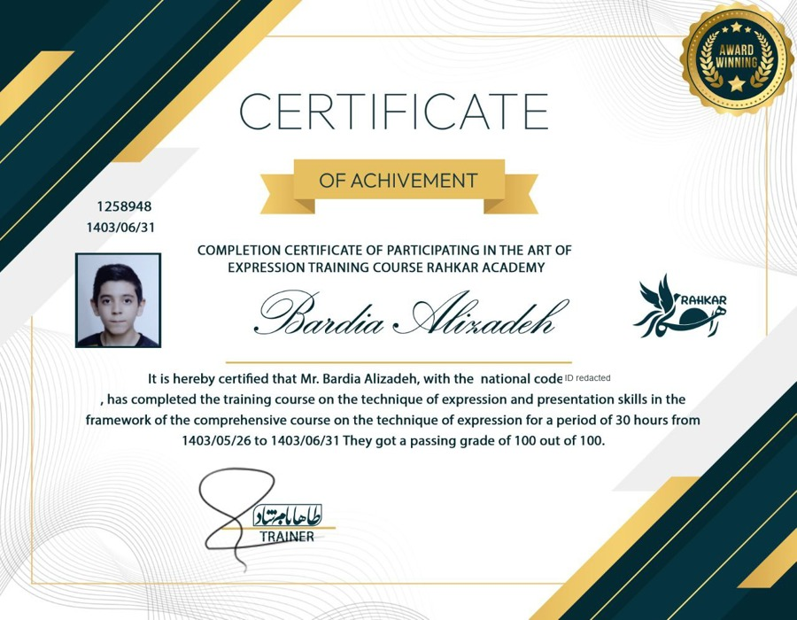

# 公众演讲与展示表达 🎤

[English](https://github.com/FarlandGame/FarlandGame/blob/main/docs/credentials/public-speaking.en.md) · [日本語](https://github.com/FarlandGame/FarlandGame/blob/main/docs/credentials/public-speaking.ja.md) · [فارسی](https://github.com/FarlandGame/FarlandGame/blob/main/docs/credentials/public-speaking.fa.md) · [Deutsch](https://github.com/FarlandGame/FarlandGame/blob/main/docs/credentials/public-speaking.de.md) · [Français](https://github.com/FarlandGame/FarlandGame/blob/main/docs/credentials/public-speaking.fr.md) · [Español](https://github.com/FarlandGame/FarlandGame/blob/main/docs/credentials/public-speaking.es.md) · [Português (Brasil)](https://github.com/FarlandGame/FarlandGame/blob/main/docs/credentials/public-speaking.pt-BR.md) · [Italiano](https://github.com/FarlandGame/FarlandGame/blob/main/docs/credentials/public-speaking.it.md) · [Nederlands](https://github.com/FarlandGame/FarlandGame/blob/main/docs/credentials/public-speaking.nl.md) · [Polski](https://github.com/FarlandGame/FarlandGame/blob/main/docs/credentials/public-speaking.pl.md) · [Українська](https://github.com/FarlandGame/FarlandGame/blob/main/docs/credentials/public-speaking.uk.md) · [Türkçe](https://github.com/FarlandGame/FarlandGame/blob/main/docs/credentials/public-speaking.tr.md) · [Русский](https://github.com/FarlandGame/FarlandGame/blob/main/docs/credentials/public-speaking.ru.md) · [简体中文](https://github.com/FarlandGame/FarlandGame/blob/main/docs/credentials/public-speaking.zh-CN.md) · [繁體中文](https://github.com/FarlandGame/FarlandGame/blob/main/docs/credentials/public-speaking.zh-TW.md) · [한국어](https://github.com/FarlandGame/FarlandGame/blob/main/docs/credentials/public-speaking.ko.md) · [हिन्दी](https://github.com/FarlandGame/FarlandGame/blob/main/docs/credentials/public-speaking.hi.md) · [Bahasa Indonesia](https://github.com/FarlandGame/FarlandGame/blob/main/docs/credentials/public-speaking.id.md)

如今，公众表达是我的强项之一。我通过 Taha Bamshad 的课程提升自信与沟通能力；所提供的 Rahkar Academy 证书记载了 30 小时的培训和 100 分中的 100 分。

表达并非一直让我感到轻松。正如我在个人故事中提到的，我曾与双胞胎兄弟 Armiya 一起参加演讲课程。本页展示的是我个人的证书，并非颁发给我们两人的共同证书。在展示创意作品、凝聚团队共同实现想法时，沟通对我很重要。

> 从调试代码到把想法讲清楚——有时候，后者需要的括号反而更少。🎤😄

## 证书记载的信息

| 项目 | 记载内容 |
|---|---|
| 获证人 | Bardia Alizadeh |
| 培训机构 | Rahkar Academy |
| 原件注明的培训师 | Taha Bamshad · طاها بامشاد |
| 时长 | 30 小时 |
| 记载分数 | 100/100 |
| 培训期间 | 1403/05/26 – 1403/06/31 |
| 证书日期 | 1403/06/31 |
| 证书编号 | 1258948 |

*使用伊朗太阳历日期；未宣称已换算为公历*

## 公开的原件图片

所提供的证书原本就是英文。上面印刷的姓名为 Bardia Alizadeh；我在作品集中使用 Bardiya Alizadeh 这一拼写。公开的原件副本仅遮盖了国民身份号码，并移除了元数据。未遮盖的照片保持私密。

**公开分享时已遮盖国民身份号码**

[公开的原件图片](https://github.com/FarlandGame/FarlandGame/blob/main/assets/credentials/public-speaking/source-public-redacted.png)

## 非官方英文阅读版

新的英文图片是明确标注的非官方誊录版，方便阅读，并非官方补发证书。没有重绘签名或学院印章。原件上的通用装饰性获奖徽章，并不能证明另有比赛奖项或教学资格。

[释读说明与来源](https://github.com/FarlandGame/FarlandGame/blob/main/assets/credentials/public-speaking/PROVENANCE.json)

[释读说明与来源](https://github.com/FarlandGame/FarlandGame/blob/main/docs/credentials/readings.en.md) · [我的其他作品集内容](https://github.com/FarlandGame/FarlandGame/blob/main/docs/credentials/swimming.zh-CN.md)

[返回我的作品集](https://github.com/FarlandGame)
