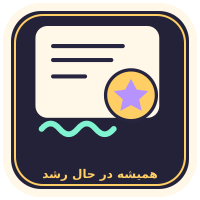
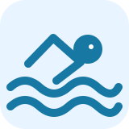
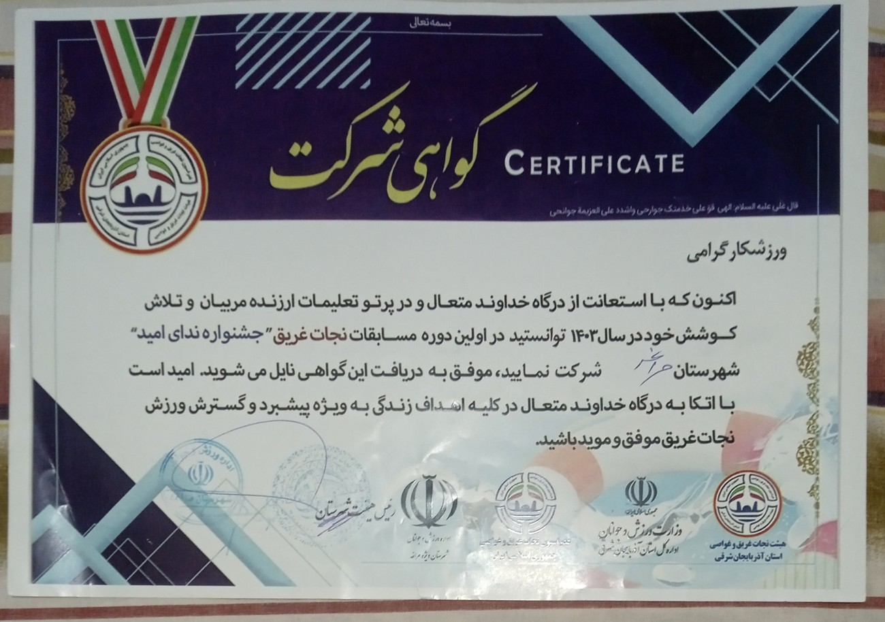
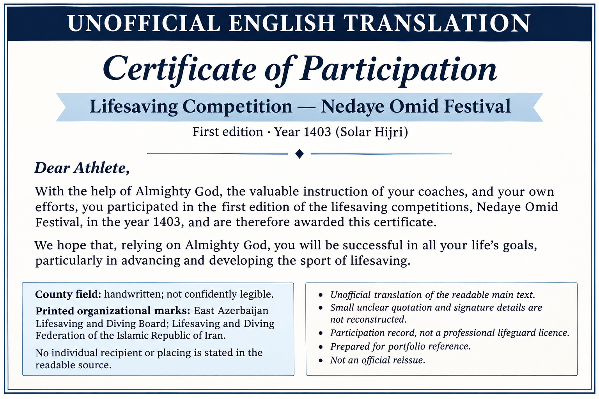
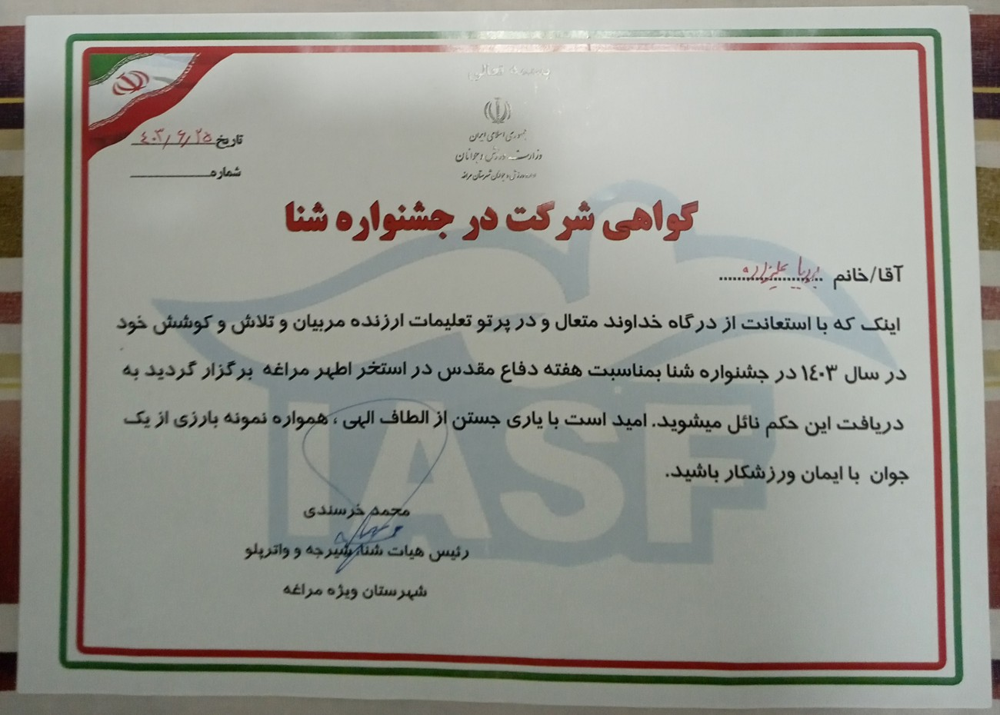
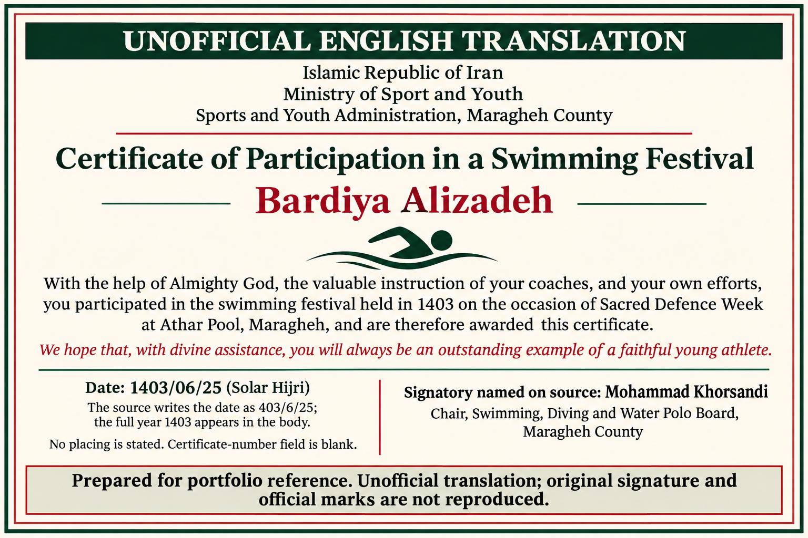

# شنا و تجربهٔ مسابقه 🏊

<!-- CREDENTIAL_STICKER -->

[English](https://github.com/FarlandGame/FarlandGame/blob/main/docs/credentials/swimming.en.md) · [日本語](https://github.com/FarlandGame/FarlandGame/blob/main/docs/credentials/swimming.ja.md) · [فارسی](https://github.com/FarlandGame/FarlandGame/blob/main/docs/credentials/swimming.fa.md) · [Deutsch](https://github.com/FarlandGame/FarlandGame/blob/main/docs/credentials/swimming.de.md) · [Français](https://github.com/FarlandGame/FarlandGame/blob/main/docs/credentials/swimming.fr.md) · [Español](https://github.com/FarlandGame/FarlandGame/blob/main/docs/credentials/swimming.es.md) · [Português (Brasil)](https://github.com/FarlandGame/FarlandGame/blob/main/docs/credentials/swimming.pt-BR.md) · [Italiano](https://github.com/FarlandGame/FarlandGame/blob/main/docs/credentials/swimming.it.md) · [Nederlands](https://github.com/FarlandGame/FarlandGame/blob/main/docs/credentials/swimming.nl.md) · [Polski](https://github.com/FarlandGame/FarlandGame/blob/main/docs/credentials/swimming.pl.md) · [Українська](https://github.com/FarlandGame/FarlandGame/blob/main/docs/credentials/swimming.uk.md) · [Türkçe](https://github.com/FarlandGame/FarlandGame/blob/main/docs/credentials/swimming.tr.md) · [Русский](https://github.com/FarlandGame/FarlandGame/blob/main/docs/credentials/swimming.ru.md) · [简体中文](https://github.com/FarlandGame/FarlandGame/blob/main/docs/credentials/swimming.zh-CN.md) · [繁體中文](https://github.com/FarlandGame/FarlandGame/blob/main/docs/credentials/swimming.zh-TW.md) · [한국어](https://github.com/FarlandGame/FarlandGame/blob/main/docs/credentials/swimming.ko.md) · [हिन्दी](https://github.com/FarlandGame/FarlandGame/blob/main/docs/credentials/swimming.hi.md) · [Bahasa Indonesia](https://github.com/FarlandGame/FarlandGame/blob/main/docs/credentials/swimming.id.md)

در کنار انیمیشن‌سازی و برنامه‌نویسی، در رویدادهای شنا و نجات غریق هم شرکت کرده‌ام. این صفحه دو گواهی شرکت مربوط به سال ۱۴۰۳ را حفظ می‌کند و اطلاعات نوشته‌شده روی آن‌ها را از خاطرهٔ شخصی‌ام دربارهٔ مقام اول جدا نگه می‌دارد.

## خاطرهٔ من از مسابقه

به یاد دارم که در یک مسابقهٔ شنا در استخر رصد مراغه نفر اول شدم. تاریخ مسابقه، مادهٔ شنا، مسافت یا ردهٔ سنی را به یاد ندارم. هیچ‌کدام از دو گواهیِ عکس‌شده رتبه‌ای را ذکر نمی‌کنند؛ بنابراین این خاطره را به‌عنوان رتبهٔ تأییدشده با این مدارک معرفی نمی‌کنم.

روی گواهی نام استخر اطهر آمده، اما خاطرهٔ من مربوط به استخر رصد است. اینجا آن‌ها را جدا نگه می‌دارم و بدون توضیح یک رویداد واحد فرض نمی‌کنم. مدارک، شرکت در رویدادها را نشان می‌دهند؛ گفتهٔ مربوط به مقام اول از خاطرهٔ خودم می‌آید.

> پشت میز می‌شود از میان‌برهای صفحه‌کلید استفاده کرد؛ توی استخر هنوز باید تمام طول را شنا کنم! 🏊⌨️😄

## رویداد نجات غریق: جشنوارهٔ ندای امید

مدرک بالایی، شرکت در نخستین دورهٔ مسابقات نجات غریق جشنوارهٔ ندای امید در سال ۱۴۰۳ را ثبت کرده است. خطاب آن «ورزشکار گرامی» است و نام شخصی ندارد. نام شهرستان در قسمت دست‌نویس با اطمینان خوانده نمی‌شود؛ جزئیات ناخوانای امضا و نقل‌قول تزئینیِ کوچک بازسازی نشده‌اند. این مدرک، گواهی شرکت است و پروانهٔ حرفه‌ای نجات غریق نیست.

### نسخهٔ خوانای انگلیسیِ غیررسمی

## شرکت در جشنوارهٔ شنا

مدرک پایینی نام بردیا علیزاده و جشنوارهٔ شنا به مناسبت هفتهٔ دفاع مقدس در استخر اطهر مراغه را ذکر می‌کند. تاریخ دست‌نویس آن 403/6/25 است؛ متن مدرک سال ۱۴۰۳ را مشخص کرده، بنابراین خوانش کامل تاریخ 1403/06/25 است. قسمت شمارهٔ گواهی خالی است. رتبه، مادهٔ شنا، مسافت یا ردهٔ سنی روی آن نوشته نشده است.

| عنوان | اطلاعات ثبت‌شده |
|---|---|
| دریافت‌کننده | Bardiya Alizadeh · بردیا علیزاده |
| سال | 1403 |
| تاریخ گواهی | 1403/06/25 · 403/6/25 |
| محل درج‌شده در اصل مدرک | Athar Pool (اطهر), Maragheh |
| امضاکنندهٔ نام‌برده در اصل مدرک | Mohammad Khorsandi · محمد خرسندی |

### نسخهٔ خوانای انگلیسیِ غیررسمی

تصاویر انگلیسی، متن خوانای مدارک را ترجمه می‌کنند و برچسب غیررسمیِ مشخص دارند. نام‌های تایپ‌شده جایگزین امضای اصلی نیستند؛ هیچ مهر رسمی، امضا یا مدالی تولید نشده است. تاریخ‌ها با تقویم هجری شمسی حفظ شده‌اند.

[عکس کاملِ ارائه‌شده از گواهی‌های شنا](https://github.com/FarlandGame/FarlandGame/blob/main/assets/credentials/swimming/source-photo.jpg) · [یادداشت‌های خوانش و منشأ مدارک](https://github.com/FarlandGame/FarlandGame/blob/main/assets/credentials/swimming/PROVENANCE.json)

[یادداشت‌های خوانش و منشأ مدارک](https://github.com/FarlandGame/FarlandGame/blob/main/docs/credentials/readings.en.md) · [موارد دیگر در رزومهٔ من](https://github.com/FarlandGame/FarlandGame/blob/main/docs/credentials/public-speaking.fa.md)

[بازگشت به رزومهٔ من](https://github.com/FarlandGame)
